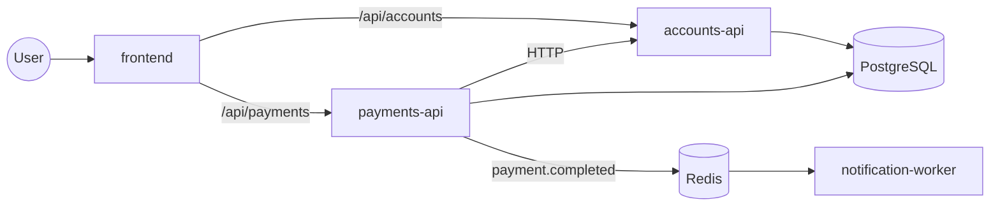
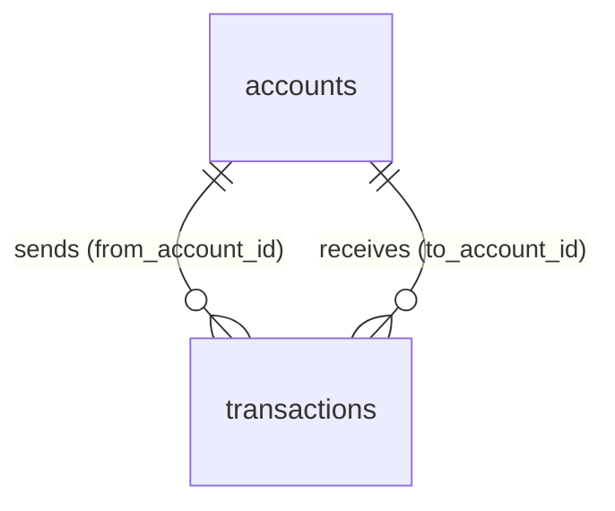

# PayFlow architecture

## Overview
PayFlow is a small digital-banking app used as the workload for a DevOps platform.
A user can open an account, check its balance, send money to another account and see their payment history.
The code is kept simple on purpose: the focus is how it is built, deployed and operated.

## Components
| frontend | nginx (unprivileged) | Serves one static HTML/JS page; the browser calls the APIs via `/api/accounts` and `/api/payments` | 8080 |
| accounts-api | Python FastAPI | Creates accounts and returns account details and balances; owns the `accounts` table | 8001 |
| payments-api | Python FastAPI | Transfers money between two accounts: rejects insufficient funds, debits the sender, credits the receiver and records the transaction in one DB transaction; publishes `payment.completed`; returns payment history | 8002 |
| notification-worker | Python | Consumes `payment.completed` events from Redis and logs a "notification sent" line (stands in for email/SMS) | 9100 (metrics only) |
| PostgreSQL | postgres | Stores accounts and transactions | 5432 |
| Redis | redis | Message queue between payments-api and the worker | 6379 |

## Request flow


## Walkthrough: one transfer
1. The user fills in from-account, to-account and amount, and clicks **Send**.
2. The browser sends `POST /api/payments` to payments-api.
3. payments-api calls accounts-api over HTTP to confirm both accounts exist.
4. In one PostgreSQL transaction, payments-api locks both account rows, checks the sender's balance,
   debits the sender, credits the receiver and inserts a row into `transactions`.
   If the balance is too low, it rolls back and returns an "insufficient funds" error.
5. After the commit, payments-api pushes a `payment.completed` event to Redis.
6. notification-worker reads the event and logs "notification sent" with the payment ID.
7. The frontend shows the result, and the payment appears in the history.

## Design decisions
- **Shared database, one owner per table.** accounts-api owns `accounts`; payments-api writes balances and
  `transactions` inside a single DB transaction so a transfer is never half-done. Trade-off: services share a
  database, which pure microservices avoid. That's accepted here to keep transfers atomic and the code simple.
- **Event after commit.** The event is published only after the DB commit, so the worker never announces a
  payment that was rolled back. If Redis is down, the payment still succeeds and the failure is logged.
- **Async notifications.** Sending notifications through Redis keeps a slow notifier from blocking payments.
- **Same-origin API paths.** The frontend uses relative `/api/...` paths, so one Ingress can route everything
  with no CORS setup.

## Cross-cutting rules
- All config comes from environment variables (12-Factor); nothing environment-specific is in the code.
- Each API exposes `/healthz` (process is alive), `/readyz` (dependencies reachable) and `/metrics` (Prometheus).
- Logs are JSON lines on stdout, one event per line, with no log files.
- Services are stateless; all state lives in PostgreSQL or Redis.
- Money is stored as `NUMERIC(12,2)`, never as a float.

## API contracts

Conventions: JSON bodies; errors as `{"detail": "..."}`; IDs are UUIDs; money is a decimal
string with 2 places (`"150.00"`); single currency `PKR`. Services serve `/accounts` and
`/payments`; the browser calls them as `/api/accounts` and `/api/payments` and the Ingress strips `/api`.

### accounts-api

| Method | Path | Success | Errors |
|---|---|---|---|
| POST | `/accounts` | 201 + account | 422 invalid body |
| GET | `/accounts/{id}` | 200 + account | 404 not found |
| GET | `/accounts/{id}/balance` | 200 + balance | 404 not found |

`POST /accounts` request:
```json
{ "owner_name": "Ali Khan", "initial_balance": "1000.00" }
```
Account response:
```json
{ "id": "3f2b...", "owner_name": "Ali Khan", "balance": "1000.00",
  "currency": "PKR", "created_at": "2026-11-02T14:00:00Z" }
```
Balance response:
```json
{ "account_id": "3f2b...", "balance": "1000.00", "currency": "PKR" }
```
Rules: `owner_name` 1–100 chars; `initial_balance` ≥ 0, defaults to `"0.00"`.

### payments-api

| Method | Path | Success | Errors |
|---|---|---|---|
| POST | `/payments` | 201 + payment | 400 same account · 404 account not found · 409 insufficient funds · 422 invalid body |
| GET | `/payments?account_id={id}` | 200 + list of payments | 422 missing account_id |

`POST /payments` request:
```json
{ "from_account_id": "3f2b...", "to_account_id": "9a1c...", "amount": "250.00" }
```
Payment response:
```json
{ "id": "7d4e...", "from_account_id": "3f2b...", "to_account_id": "9a1c...",
  "amount": "250.00", "currency": "PKR", "status": "completed",
  "created_at": "2026-11-02T14:05:00Z" }
```
History returns payments where the account is sender or receiver, newest first;
an unknown account returns an empty list.
Rules: `amount` > 0 with at most 2 decimals; `from` ≠ `to`.

Internal call: payments-api uses `GET /accounts/{id}` on accounts-api to confirm both accounts exist.

### Every service also exposes
`GET /healthz` → 200 `{"status":"ok"}` · `GET /readyz` → 200, or 503 if a dependency is down ·
`GET /metrics` → Prometheus text format.

## Data model

One PostgreSQL database, two tables. accounts-api owns `accounts`; payments-api owns
`transactions` and updates `accounts.balance` only inside a transfer.



### accounts
| Column | Type | Rules |
|---|---|---|
| id | UUID | primary key, `gen_random_uuid()` |
| owner_name | VARCHAR(100) | not null |
| balance | NUMERIC(12,2) | not null, default 0, `CHECK (balance >= 0)` |
| currency | CHAR(3) | not null, default `'PKR'` |
| created_at | TIMESTAMPTZ | not null, default `now()` |

### transactions
| Column | Type | Rules |
|---|---|---|
| id | UUID | primary key, `gen_random_uuid()` |
| from_account_id | UUID | not null, FK → accounts.id |
| to_account_id | UUID | not null, FK → accounts.id |
| amount | NUMERIC(12,2) | not null, `CHECK (amount > 0)` |
| currency | CHAR(3) | not null, default `'PKR'` |
| status | VARCHAR(20) | not null, default `'completed'` |
| created_at | TIMESTAMPTZ | not null, default `now()` |

Table check: `CHECK (from_account_id <> to_account_id)`.

### Indexes
- `transactions (from_account_id, created_at DESC)`
- `transactions (to_account_id, created_at DESC)`

Both serve the history query ("payments where the account is sender or receiver, newest first").

### Notes
- Only completed transfers are stored; a failed transfer is rolled back and counted in
  `payments_failed_total` instead.
- `balance >= 0` in the database is a backstop: the API checks first, the constraint catches bugs.
- A transfer locks both account rows in a fixed order (lower UUID first), so two
  opposite transfers at the same time can't deadlock.
