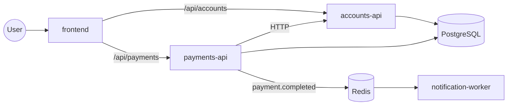

# PayFlow architecture

## Overview
PayFlow is a small digital-banking app used as the workload for a DevOps platform.
A user can open an account, check its balance, send money to another account and see their payment history.
The code is kept simple on purpose: the focus is how it is built, deployed and operated.

## Components
| frontend | nginx (unprivileged) | Serves one static HTML/JS page; the browser calls the APIs via `/api/accounts` and `/api/payments` | 8080 |
| accounts-api | Python FastAPI | Creates accounts and returns account details and balances; owns the `accounts` table | 8001 |
| payments-api | Python FastAPI | Transfers money between two accounts: rejects insufficient funds, debits the sender, credits the receiver and records the transaction in one DB transaction; publishes `payment.completed`; returns payment history | 8002 |
| notification-worker | Python | Consumes `payment.completed` events from Redis and logs a "notification sent" line (stands in for email/SMS) | 9100 (metrics only) |
| PostgreSQL | postgres | Stores accounts and transactions | 5432 |
| Redis | redis | Message queue between payments-api and the worker | 6379 |

## Request flow

## Walkthrough: one transfer
1. The user fills in from-account, to-account and amount, and clicks **Send**.
2. The browser sends `POST /api/payments` to payments-api.
3. payments-api calls accounts-api over HTTP to confirm both accounts exist.
4. In one PostgreSQL transaction, payments-api locks both account rows, checks the sender's balance,
   debits the sender, credits the receiver and inserts a row into `transactions`.
   If the balance is too low, it rolls back and returns an "insufficient funds" error.
5. After the commit, payments-api pushes a `payment.completed` event to Redis.
6. notification-worker reads the event and logs "notification sent" with the payment ID.
7. The frontend shows the result, and the payment appears in the history.

## Design decisions
- **Shared database, one owner per table.** accounts-api owns `accounts`; payments-api writes balances and
  `transactions` inside a single DB transaction so a transfer is never half-done. Trade-off: services share a
  database, which pure microservices avoid. That's accepted here to keep transfers atomic and the code simple.
- **Event after commit.** The event is published only after the DB commit, so the worker never announces a
  payment that was rolled back. If Redis is down, the payment still succeeds and the failure is logged.
- **Async notifications.** Sending notifications through Redis keeps a slow notifier from blocking payments.
- **Same-origin API paths.** The frontend uses relative `/api/...` paths, so one Ingress can route everything
  with no CORS setup.

## Cross-cutting rules
- All config comes from environment variables (12-Factor); nothing environment-specific is in the code.
- Each API exposes `/healthz` (process is alive), `/readyz` (dependencies reachable) and `/metrics` (Prometheus).
- Logs are JSON lines on stdout, one event per line, with no log files.
- Services are stateless; all state lives in PostgreSQL or Redis.
- Money is stored as `NUMERIC(12,2)`, never as a float.
